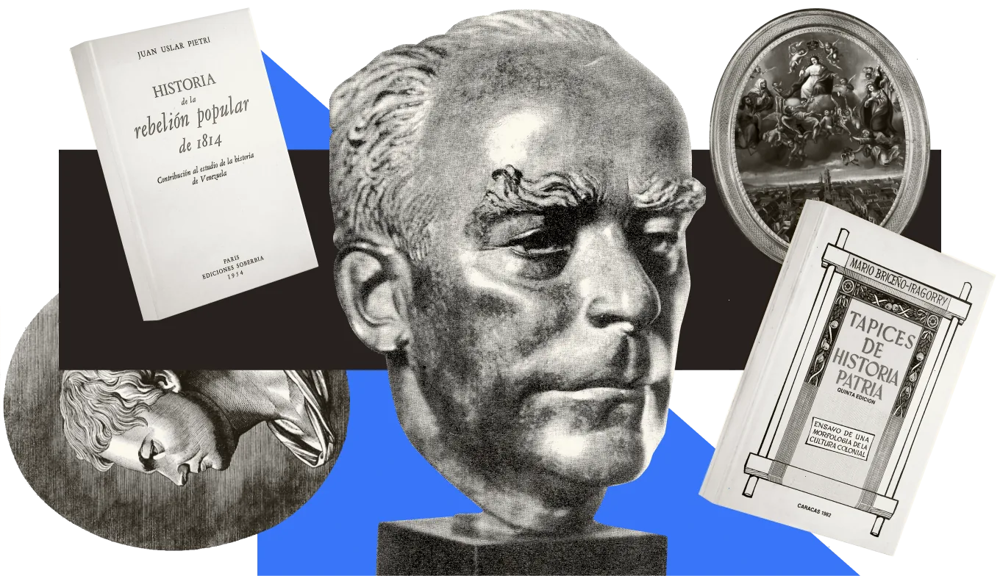

<main>
  <section id="inicio">
    

      

        

          
Bienvenido a Idearium Caribe

Welcome to Idearium Caribe

          <h1 class="es">La memoria de Venezuela, abierta a todos</h1>
          <h1 class="en">The memory of Venezuela, open to all</h1>
          
Somos una fundación cultural sin fines de lucro dedicada a seleccionar, curar y editar materiales sobre la historia de Venezuela e Hispanoamérica.

          
We are a nonprofit cultural foundation devoted to selecting, curating and editing materials on the history of Venezuela and Spanish America.

          
Digitalizamos libros, documentos y archivos en riesgo de desaparición. Los curamos y preservamos para ofrecerlos en acceso abierto a investigadores, estudiantes y comunidades en Venezuela, Hispanoamérica y el Caribe.

          
We digitize books, documents and archives at risk of disappearing. We curate and preserve them to make them openly available to researchers, students and communities in Venezuela, Latin America and the Caribbean.

        

        <figure class="collage-fig">
          
        </figure>
      

      

        <a class="pillar" href="/biblioteca/catalogo/">
          {{ catalogo | length }}
          <h2 class="es">Biblioteca Digital</h2><h2 class="en">Digital Library</h2>
          
Libros y publicaciones de historia venezolana, de libre lectura y descarga en Internet Archive.

          
Books and periodicals on Venezuelan history, free to read and download on the Internet Archive.

        </a>
        <a class="pillar" href="/colombeia.html">
          {{ collections.numeros | length }}
          <h2>Colombeia</h2>
          
Revista de historia y pensamiento venezolano e hispanoamericano, en acceso abierto.

          
An open-access journal of Venezuelan and Spanish American history and thought.

        </a>
      

    

  </section>

  
  
  
  <section id="novedades" aria-labelledby="nov-t">
    

      

Lo más reciente

Latest

        <h2 id="nov-t" class="es">Novedades</h2><h2 class="en">What's new</h2>

        <a class="more" href="/cambios.html">Registro de cambiosChangelog</a>

      

        

          <h3 class="label">Últimas incorporacionesLatest additions</h3>
          <ul class="inicio-portadas">
            
            <li><a href="{{ o.url }}">{{ o.titulo }}{{ o.titulo_en }}</a></li>
            
          </ul>
          <a class="more" href="/biblioteca/catalogo/?orden=recientes">Ver el catálogoBrowse the catalogue</a>
        

        

          <h3 class="label">Último número deLatest issue of <i>Colombeia</i></h3>
          <a class="inicio-numero" href="{{ ultNum.url }}"><b>N.º {{ ultNum.data.numero }}: {{ ultNum.data.titulo }}</b>{{ ultNum.data.fecha }}</a>
          <ul class="inicio-lista">
            
            <li><a href="{{ a.url | urlLimpia }}">{{ a.data.titulo }}</a> · {{ a.data.autores | listaAutores }}</li>
            
          </ul>
        

        

          <h3 class="label">En el sitioOn the website</h3>
          <ul class="inicio-lista">
            
            <li><time datetime="{{ c.fecha }}" class="ref">{{ c.fecha | fechaLarga("es") }}{{ c.fecha | fechaLarga("en") }}</time>{{ c.es | cursivas | safe }}{{ c.en | cursivas | safe }}</li>
            
          </ul>
        

      

    

  </section>

  <section id="actividad">
    

      

Nuestra actividad

Our activity

        <h2 class="es">De El Caribe Ilustrado</h2><h2 class="en">From El Caribe Ilustrado</h2>

        <a class="more" href="{{ sitio.boletin }}/archive" target="_blank" rel="noopener">Ver todo el archivoSee the full archive</a>

      <!-- La lista de artículos del boletín se edita en «Boletín: artículos destacados». -->
      
    

  </section>

  
</main>
